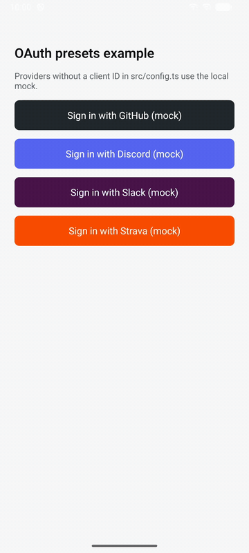

# rn-social-login

<p align="center">
  
</p>

<p align="center">

[](https://www.npmjs.com/package/@franciscodlxdev/rn-auth-core) [](https://github.com/franciscodlx/rn-social-login/actions/workflows/ci.yml) [](LICENSE)

</p>

**Agrega "Iniciar sesión con GitHub, X, LinkedIn, TikTok…" a tu app de React Native con una sola API: navegador del sistema, PKCE y cero secrets en la app.**

Sin WebView: el usuario inicia sesión en `ASWebAuthenticationSession` (iOS) o Custom Tabs (Android), con las cookies y gestores de contraseñas que ya usa. El `client_secret` se queda en tu backend, y los errores llegan normalizados (`CANCELLED`, `NETWORK`, `PROVIDER_ERROR`…) sin importar el proveedor.

## Instalación

```sh
npm i @franciscodlxdev/react-native-x-login @franciscodlxdev/rn-auth-core
cd ios && pod install
```

En Android agrega el esquema de tu app en `android/app/build.gradle`: `manifestPlaceholders["authCoreRedirectScheme"] = "miapp"`. Con Expo es un config plugin: `plugins: [["@franciscodlxdev/rn-auth-core", { "scheme": "miapp" }]]`.

## Ejemplo mínimo

```ts
import { xLogin } from '@franciscodlxdev/react-native-x-login';

const { profile } = await xLogin.signIn({
  clientId: 'TU_CLIENT_ID',        // portal de X → OAuth 2.0, app tipo "Native App"
  redirectUri: 'miapp://callback', // regístrala tal cual en X
  exchangeCode: true,              // cliente público: el canje se hace en el dispositivo con PKCE
});

console.log(`Hola, @${profile?.username}`);
```

X es un cliente público, así que este ejemplo no necesita backend. LinkedIn, GitHub, TikTok y los demás devuelven un `code` que tu backend canjea con el secret; cada paquete trae el canje listo en Node y Laravel. Detalles de X en [`packages/x-login`](packages/x-login).

<sub>El GIF: Ejemplo `examples/oauth-presets-example` en el emulador de Android contra el proveedor local (`examples/mock-idp`). Probado también con cuentas reales de LinkedIn, X, GitHub, Discord, Telegram y TikTok en iPhone y Android.</sub>

## Paquetes

| Paquete                                            | Qué hace                                                           | Estado                   |
| -------------------------------------------------- | ------------------------------------------------------------------ | ------------------------ |
| [`@franciscodlxdev/rn-auth-core`](packages/auth-core) | PKCE, `state`/`nonce`, navegador del sistema, errores normalizados | Probado en iOS y Android |
| `@franciscodlxdev/react-native-linkedin-login`        | LinkedIn con OpenID Connect                                        | Probado con LinkedIn     |
| `@franciscodlxdev/react-native-x-login`               | X con OAuth 2.0 + PKCE                                             | Probado con X |
| `@franciscodlxdev/react-native-mercadolibre-login`    | Mercado Libre con selector de país                                 | Probado con mock         |
| `@franciscodlxdev/react-native-twitch-login`          | Twitch con OIDC                                                    | Probado con mock         |
| `@franciscodlxdev/rn-oauth-presets`                   | GitHub, Discord, Slack y Strava                                    | Probado con GitHub, Discord |
| `@franciscodlxdev/react-native-telegram-login`        | Telegram con OpenID Connect                                        | Probado con Telegram |
| `@franciscodlxdev/react-native-tiktok-login`          | TikTok Login Kit (flujo web)                                       | Probado con TikTok (sandbox) |
| `@franciscodlxdev/react-native-entra-native-auth`     | Entra External ID: alta, login y reset sin navegador               | Probado con mock         |

Cada proveedor es un paquete independiente (versión, changelog y publicación propios) que solo aporta endpoints, scopes y mapeo de perfil; el flujo y la seguridad viven en el núcleo.

## Estructura

```
packages/auth-core            núcleo (TurboModule: Swift + Kotlin)
packages/linkedin-login       LinkedIn (JS sobre el núcleo)
examples/auth-core-example    app para probar el núcleo en iOS y Android
examples/linkedin-login-example  app para probar LinkedIn
packages/x-login              X / Twitter (JS sobre el núcleo)
examples/x-login-example     app para probar X
packages/mercadolibre-login  Mercado Libre (JS sobre el núcleo)
examples/mercadolibre-login-example  app para probar Mercado Libre
examples/mercadolibre-backend  backend de ejemplo: redirect https y canje con secret + PKCE
packages/twitch-login        Twitch con OpenID Connect (JS sobre el núcleo)
examples/twitch-login-example  app para probar Twitch
examples/twitch-backend      backend de ejemplo: canje con secret y verificación de id_token + nonce
packages/oauth-presets       GitHub, Discord, Slack y Strava (JS sobre el núcleo)
examples/oauth-presets-example  app para probar los cuatro presets
examples/presets-backend     backend de ejemplo: una ruta de redirect y de canje por proveedor
packages/telegram-login      Telegram con OpenID Connect + PKCE (JS sobre el núcleo)
examples/telegram-login-example  app para probar Telegram
examples/telegram-backend    backend de ejemplo: canje con secret + PKCE y verificación del id_token
packages/tiktok-login        TikTok Login Kit, flujo web (JS sobre el núcleo)
examples/tiktok-login-example  app para probar TikTok
examples/tiktok-backend      backend de ejemplo: canje con client key + secret y perfil
packages/entra-native-auth   Microsoft Entra External ID, native authentication (JS sobre el núcleo)
examples/entra-native-auth-example  app para probar alta, inicio de sesión y restablecimiento
examples/mock-entra          servidor local que imita la API de native authentication
examples/linkedin-backend     backend de ejemplo: redirect https y canje con el secret
examples/mock-idp             proveedor OAuth/OIDC local, sin credenciales reales
scripts/new-example.sh        crea la app de ejemplo de un plugin nuevo
```

## Desarrollo

Requiere Node 22, pnpm 12, Xcode y Android SDK.

```sh
pnpm install
pnpm test          # pruebas unitarias
pnpm typecheck
pnpm lint
pnpm build         # compila los paquetes con bob
```

Probar el flujo completo, sin cuenta en ningún proveedor:

```sh
pnpm --filter @franciscodlxdev/mock-idp start            # proveedor local en :4000
pnpm --filter @franciscodlxdev/rn-auth-core-example start # Metro
pnpm --filter @franciscodlxdev/rn-auth-core-example ios   # o android
```

Más detalle en [CONTRIBUTING.md](CONTRIBUTING.md). Vulnerabilidades: [SECURITY.md](SECURITY.md).

## La familia

La misma API, los mismos proveedores y los mismos códigos de error en cada plataforma:

| Plataforma | Repositorio |
| ---------- | ----------- |
| React Native (y Expo) | **este repo** |
| Flutter | [flutter_social_login](https://github.com/franciscodlx/flutter_social_login) |
| Capacitor / Ionic | [capacitor-social-login](https://github.com/franciscodlx/capacitor-social-login) |
| NativeScript | [nativescript-social-login](https://github.com/franciscodlx/nativescript-social-login) |
| NativePHP Mobile | [nativephp-social-login](https://github.com/franciscodlx/nativephp-social-login) |

## Licencia

MIT
