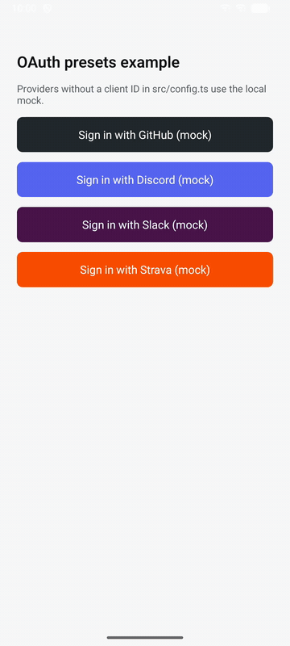

# @franciscodlxdev/rn-auth-core

<p align="center"></p>

OAuth 2.0 + PKCE para React Native (iOS, Android, Expo) en el navegador del sistema: `ASWebAuthenticationSession` en iOS y Custom Tabs en Android. Sin WebView y sin `clientSecret` en la app.

Es el núcleo de la familia [rn-social-login](../..): úsalo directo con cualquier proveedor OAuth 2.0 / OpenID Connect, o a través de un paquete de proveedor.

## Compatibilidad

| Paquete | React Native   | Expo SDK                       | iOS    | Android        | New Architecture        |
| ------- | -------------- | ------------------------------ | ------ | -------------- | ----------------------- |
| 0.1.x   | 0.88 (probado) | development build (no Expo Go) | ≥ 15.1 | ≥ 7.0 (API 24) | Requerida (TurboModule) |

## Instalación

```sh
npm i @franciscodlxdev/rn-auth-core
cd ios && pod install
```

Android: declara el esquema de tu redirect en `android/app/build.gradle`:

```groovy
android {
    defaultConfig {
        manifestPlaceholders["authCoreRedirectScheme"] = "miapp"
    }
}
```

Expo:

```json
{ "plugins": [["@franciscodlxdev/rn-auth-core", { "scheme": "miapp" }]] }
```

Detalle por plataforma: [iOS](docs/ios.md), [Android](docs/android.md), [Expo](docs/expo.md).

## Configurar el proveedor

1. Crea la app en el portal del proveedor como cliente **público / nativo** (sin secret).
2. Registra el redirect URI: `miapp://callback`, o un Universal Link / App Link.
3. Anota el `clientId` y los scopes.

## Uso

Con un proveedor definido una vez:

```tsx
import {
  createProviderLogin,
  useProviderLogin,
} from '@franciscodlxdev/rn-auth-core';

const login = createProviderLogin({
  id: 'mi-idp',
  authorizationEndpoint: 'https://idp.example.com/authorize',
  tokenEndpoint: 'https://idp.example.com/token', // solo si el proveedor admite clientes públicos
  userInfoEndpoint: 'https://idp.example.com/userinfo',
  issuer: 'https://idp.example.com',
  defaultScopes: ['openid', 'profile', 'email'],
  useNonce: true,
});

function LoginButton() {
  const { signIn, loading, result, error } = useProviderLogin(login, {
    clientId: 'TU_CLIENT_ID',
    redirectUri: 'miapp://callback',
  });
  return <Button title="Entrar" disabled={loading} onPress={() => signIn()} />;
}
```

Sin hook:

```ts
const { code, codeVerifier, nonce, redirectUri } = await login.signIn({
  clientId,
  redirectUri: 'miapp://callback',
});
// Envía code + codeVerifier + redirectUri a tu backend.
```

### API

| Función                                                              | Devuelve                                                                                                                                                           |
| -------------------------------------------------------------------- | ------------------------------------------------------------------------------------------------------------------------------------------------------------------ |
| `signIn(options)`                                                    | `{ code, codeVerifier, state, nonce?, redirectUri, params }`; con `exchangeCode: true` agrega `accessToken`, `refreshToken`, `idToken`, `idTokenClaims`, `profile` |
| `signOut({ clientId, token })`                                       | Revoca el token si el proveedor tiene endpoint de revocación                                                                                                       |
| `isAvailable()`                                                      | `true` si se puede abrir el navegador del sistema                                                                                                                  |
| `authorize(request)`                                                 | El flujo sin proveedor predefinido                                                                                                                                 |
| `exchangeCode`, `refreshAccessToken`, `revokeToken`, `fetchUserInfo` | Llamadas de cliente público al proveedor                                                                                                                           |
| `decodeIdToken`, `validateIdTokenClaims`                             | Claims del `id_token` y revisión de `iss`, `aud`, `exp`, `nonce`                                                                                                   |
| `createPkcePair()`, `randomString()`                                 | PKCE S256 y aleatorios del CSPRNG nativo                                                                                                                           |

Opciones de `signIn`: `clientId`, `redirectUri`, `callbackUri`, `scopes`, `extraParams`, `prefersEphemeralSession` (no comparte cookies con el navegador; en iOS además evita el aviso de confirmación), `exchangeCode`.

### Proveedores que solo aceptan redirect https

Si el proveedor no admite `miapp://…`, registra una URL https de tu backend como `redirectUri` y haz que reenvíe la query a tu app; `callbackUri` es la URL donde la app espera:

```ts
signIn({
  clientId,
  redirectUri: 'https://api.miapp.com/auth/callback', // lo ve el proveedor
  callbackUri: 'miapp://callback', // lo recibe la app
});
```

## Backend (canje del código)

Si el proveedor exige `client_secret`, el canje va en tu servidor. Node/Express:

```js
app.post('/auth/exchange', async (req, res) => {
  const { code, codeVerifier, redirectUri } = req.body;
  const r = await fetch('https://idp.example.com/token', {
    method: 'POST',
    headers: { 'Content-Type': 'application/x-www-form-urlencoded' },
    body: new URLSearchParams({
      grant_type: 'authorization_code',
      code,
      code_verifier: codeVerifier,
      redirect_uri: redirectUri,
      client_id: process.env.CLIENT_ID,
      client_secret: process.env.CLIENT_SECRET,
    }),
  });
  res.status(r.status).json(await r.json());
});
```

Laravel:

```php
Route::post('/auth/exchange', function (Request $request) {
    return Http::asForm()->post('https://idp.example.com/token', [
        'grant_type' => 'authorization_code',
        'code' => $request->input('code'),
        'code_verifier' => $request->input('codeVerifier'),
        'redirect_uri' => $request->input('redirectUri'),
        'client_id' => config('services.idp.client_id'),
        'client_secret' => config('services.idp.client_secret'),
    ])->json();
});
```

## Errores normalizados

Todo falla con un `AuthError` cuyo `code` es uno de:

| Código           | Cuándo                                                                              |
| ---------------- | ----------------------------------------------------------------------------------- |
| `CANCELLED`      | El usuario cerró el navegador o rechazó el permiso (`access_denied`)                |
| `NETWORK`        | No se pudo contactar al proveedor                                                   |
| `INVALID_CONFIG` | Falta `clientId` / `redirectUri`, endpoint sin https, o ya hay un login abierto     |
| `PROVIDER_ERROR` | El proveedor devolvió un error, el `state` no coincide o el `id_token` no es válido |
| `NOT_SUPPORTED`  | Módulo nativo sin enlazar (Expo Go), sin navegador, o redirect https en iOS < 17.4  |

`error.providerError` y `error.providerErrorDescription` traen lo que respondió el proveedor.

## Seguridad

- No hay `clientSecret` en la app: PKCE (S256) liga el código al dispositivo que lo pidió.
- `state` y `nonce` salen del CSPRNG nativo; un redirect con otro `state` se rechaza.
- El `id_token` se decodifica **sin verificar la firma**; verifícala en tu backend.
- La librería no guarda tokens. Usa Keychain / Keystore.
- http solo se acepta hacia `localhost`, `127.0.0.1` y `10.0.2.2`, para el servidor de pruebas.

Más en [SECURITY.md](../../SECURITY.md).

## Probar sin credenciales

`examples/auth-core-example` corre el flujo completo contra `examples/mock-idp`, un proveedor OIDC local. Ver [CONTRIBUTING.md](../../CONTRIBUTING.md).

## Licencia

MIT
